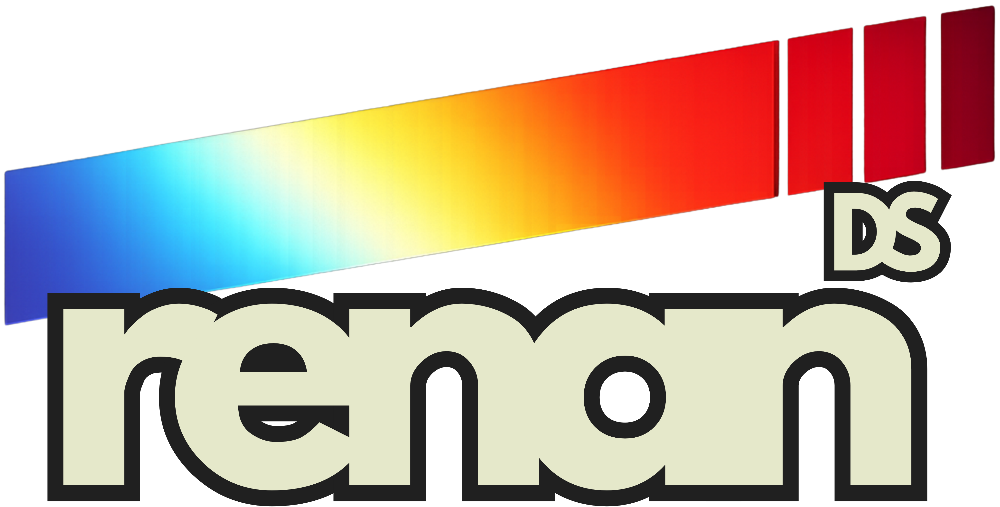

<p align="center">
  
</p>

# BuildGuard AI

**Production-oriented ML platform for construction cost-overrun and
schedule-delay risk**, built on Earned Value Management analytics —
leakage-safe features, calibrated probabilities, uncertainty, and
explainability, deployed at zero recurring cost.

> ✅ **v1.0.2 — released.** Live demo:
> <https://buildguard-ai-renands.streamlit.app/>. See
> [`CHANGELOG.md`](CHANGELOG.md) for the release history and
> [`docs/LIMITATIONS.md`](docs/LIMITATIONS.md) for what this version
> deliberately does not cover.

[](https://github.com/pinheiro-dataworks/buildguard-ai/actions/workflows/ci.yml)
[](https://github.com/pinheiro-dataworks/buildguard-ai/actions/workflows/security.yml)
[](LICENSE)
[]()
[](https://buildguard-ai-renands.streamlit.app/)

---

## 1. Project Overview

BuildGuard AI evolves an earlier descriptive cost-monitoring concept
(*GETEC Analytics*) into a complete, reproducible, testable, deployable, and
monitored ML system for construction portfolio risk. It answers five
executive questions:

1. Which projects are most likely to exceed their approved budget?
2. Which projects are most likely to miss their contractual schedule?
3. What is the expected final cost of each project?
4. What factors are currently driving the risk?
5. What should management investigate first?

**Positioning:** decision support for construction cost and schedule risk —
never marketed as infallible, autonomous, or a guarantee of outcomes.

## 2. Business Problem

Construction portfolios routinely discover cost overruns and schedule slips
only after they have already happened, because monitoring is descriptive
(dashboards of what occurred) rather than predictive (what is likely to
occur, and why). BuildGuard AI targets three concrete predictions —
cost-overrun probability, schedule-delay probability, and estimate-at-
completion — built on top of a formal Earned Value Management (EVM) layer,
so that risk is visible early enough to act on.

## 3. Objectives

- **Cost-overrun risk:** the calibrated probability that a project's
  inflation-adjusted final cost exceeds its approved budget by more than a
  10% tolerance, with a risk band and the SHAP drivers behind it.
- **Schedule-delay risk:** the calibrated probability that a project
  finishes more than 14 days after its planned completion date.
- **Estimate at completion:** a final-cost forecast with an 80%
  prediction interval.
- **Prioritization support:** a ranked portfolio view, so management can
  see where to look first.

Tolerances live in `configs/base.yaml`. Users, scope, and the full set of
functional and non-functional requirements are in
[`docs/REQUIREMENTS.md`](docs/REQUIREMENTS.md).

## 4. Dataset

A deterministic, synthetic construction-portfolio dataset generated by
`src/buildguard/data/synthetic.py` (400 projects, 11,953 monthly
snapshots, work packages, change orders, suppliers). No confidential or
proprietary project data is used anywhere in this repository. See
[`docs/DATA_PRIVACY.md`](docs/DATA_PRIVACY.md) for the full data policy.

## 5. Data Architecture

Six core tables (Projects, Project Snapshots, Work Packages, Change
Orders, Suppliers, Economic Index), each enforced by a `pandera` data
contract (`src/buildguard/data/contracts.py`), generated deterministically
by `src/buildguard/data/synthetic.py`. Full details, including the EVM and
inflation-normalization methodology, in
[`docs/ARCHITECTURE.md`](docs/ARCHITECTURE.md) and
[`docs/DATA_DICTIONARY.md`](docs/DATA_DICTIONARY.md). Anti-leakage rules
and the temporal train/calibration/test split are documented in
[`docs/LEAKAGE_POLICY.md`](docs/LEAKAGE_POLICY.md).

## 6. Exploratory Data Analysis

[`notebooks/02_eda.ipynb`](notebooks/02_eda.ipynb) — portfolio composition,
budget and EVM-ratio (CPI/SPI) distributions, and realized outcome rates,
run top-to-bottom against the deterministic synthetic portfolio. **Real
findings:** CPI averages 0.86 (below the 1.0 on-plan line — this portfolio
skews toward cost pressure by construction); CPI and SPI are only weakly
correlated (r = 0.27), which is why cost-overrun and schedule-delay are
modeled as two separate tasks rather than one combined label; 345 of 400
projects have already completed, and among those 47.0% overran cost and
50.4% ran behind schedule — both far from a rare-event base rate. Figures
saved to [`reports/figures/`](reports/figures/).

## 7. Feature Engineering

- **EVM** (`features/evm.py`): CV, SV, CPI, SPI, two independent EAC
  baselines, ETC, VAC.
- **Inflation normalization** (`features/inflation.py`): decomposes nominal
  cost variance into an operational (execution) component and an inflation
  component — see [`docs/ARCHITECTURE.md`](docs/ARCHITECTURE.md#5-inflation-normalization-methodology).
- **Temporal / lifecycle** (`features/temporal.py`): lifecycle position and
  stage, plus trend/persistence signals (e.g. consecutive months of SPI
  decline).

All three are assembled by one leakage-safe function,
`features/pipeline.py: build_feature_table`, shared by training, batch
scoring, and the API: every feature is available on or before the row's
prediction date, and change orders are joined with a backward as-of join
that cannot see the future.

## 8. Modeling

**Baselines** (`models/baselines.py`) are built and validated first —
every candidate model must beat a meaningful construction-management
baseline (a CPI rule, the deterministic EVM estimate at completion), not
just a naive one.

**Candidates** (`models/classification.py`, `regression.py`): Random
Forest and LightGBM, tuned with Optuna (`GroupKFold` on `project_id`),
compared against baselines on the calibration split (`scripts/train.py`,
`make train`). Real results, full scale (400 projects):

| Task | Champion | Score | Best baseline |
|---|---|---|---|
| Cost-overrun risk | Random Forest | 0.898 AUC | 0.888 (logistic regression) |
| Schedule-delay risk | LightGBM | 0.974 AUC | 0.816 (logistic regression) |
| Final-cost estimate | **Deterministic EAC (baseline)** | 1.96M MAE | 4.11M (tuned LightGBM) |

Two tasks are won by real ML models; the third is won decisively by the
plain EVM Estimate-at-Completion formula — a genuine, reproducible finding
(confirmed at two different scales), not a shortcut. Every experiment run
is tracked in MLflow (`sqlite:///mlruns/mlflow.db`, zero-cost/local); full
rationale and trade-offs in [ADR-0006](docs/adr/0006-model-selection.md).
Calibration, thresholds, and uncertainty are covered under Evaluation.

## 9. Evaluation

**Calibration** (`models/calibration.py`, `make calibrate`): isotonic
calibration improves both classifiers' Brier score (cost-overrun 0.133 →
0.122; schedule-delay 0.072 → 0.059) and becomes the production artifact.

**Threshold** (`models/thresholds.py`): optimized against
`configs/business.yaml`'s cost matrix, never a silent 0.50 default —
cost-overrun risk at 0.080 (98% recall / 68% precision), schedule-delay
risk at 0.140 (98% recall / 86% precision).

**Uncertainty** (`models/uncertainty.py`): split-conformal 80% interval
around the final-cost estimate — ±$3.09M, empirically achieving 0.801
coverage. Full rationale in [ADR-0007](docs/adr/0007-calibration-strategy.md),
[ADR-0008](docs/adr/0008-threshold-policy.md), [ADR-0009](docs/adr/0009-uncertainty-method.md).

**Slice analysis** (`evaluation/slices.py`): six dimensions (project type,
size, construction standard, lifecycle stage, geography, budget segment)
plus an inflation-regime dimension, scored on the held-out test split.
**Real finding:** cost-overrun risk's global AUC (0.9495) hides a
materially weaker subgroup — the `ES` state slice scores AUC 0.597 (n=76),
close to random. Documented, not hidden.

**Explainability** (`explainability/shap.py`): SHAP `TreeExplainer`
(`model_output="probability"`) plus permutation importance for both
classifiers. Top global drivers: cost-overrun risk — `cpi` and
`operational_variance`; schedule-delay risk — `spi` and
`lifecycle_fraction`. Mandatory disclaimer on every explanation surface:
*"Feature attribution explains the model prediction; it does not
establish causality."* `final_cost`'s formula champion has no learned
explanation to attach — the formula itself is the explanation.

Full rationale, both real findings, and the failure-analysis methodology:
[ADR-0010](docs/adr/0010-evaluation-explainability-design.md).

## 10. Results

Final, one-shot evaluation on the **test split** (752 rows / 41 projects,
reserved for this single evaluation — [ADR-0003](docs/adr/0003-temporal-validation.md)):

| Task | Test metric | At the frozen threshold |
|---|---|---|
| Cost-overrun risk | ROC-AUC 0.9495 · PR-AUC 0.9008 | recall 97.4% / precision 55.1% @ 0.080 |
| Schedule-delay risk | ROC-AUC 0.9002 · PR-AUC 0.8949 | recall 92.9% / precision 72.5% @ 0.140 |
| Final-cost estimate | MAE $1.61M · RMSE $3.03M · R² 0.959 · MAPE 7.0% | 80% interval, 89.9% empirical coverage |

Two things worth being direct about: `schedule_delay`'s isotonic
calibration, which won in-sample (Brier 0.059), degrades to 0.145
out-of-sample — a genuine generalization gap. `final_cost`'s conformal
interval over-covers (89.9% vs. an 80% target) — conservative, not wrong,
but wider than strictly necessary. Full failure analysis (false
negatives/positives with SHAP drivers, hardest subgroups,
out-of-distribution rows, largest regression errors) in
[`reports/error_analysis/`](reports/error_analysis/); full numbers in
[`reports/experiments/test_set_metrics.json`](reports/experiments/test_set_metrics.json).

## 11. Business Impact

**Scenario-based estimated impact** — explicitly never a claim of
realized savings:

```
active_projects × avg_financial_exposure × overrun_prevalence
× model_recall × avoidable_impact_assumption
= estimated_decision_support_value
```

Computed by `scripts/business_impact.py` (`make business-impact`) from
real numbers — the current portfolio's 55 in-flight (unresolved) projects,
their $18.9M average approved budget, the 47.0% cost-overrun prevalence
measured on the 345 already-completed projects, and the cost-overrun
model's real held-out test recall (97.4% @ threshold 0.080) — combined
with one explicit, adjustable business assumption
(`configs/business.yaml: business_impact.avoidable_impact_assumption`,
30%: even a correctly flagged overrun isn't fully avoidable). **Result:
$142.9M.** Every factor is shown wherever this number appears (README,
Executive Overview page) precisely so the estimate can be recomputed or
challenged, not taken on faith. Full numbers in
[`reports/experiments/business_impact.json`](reports/experiments/business_impact.json).

## 12. Architecture

Zero-cost public path: GitHub → GitHub Actions (lint/test/type-check) →
Streamlit Community Cloud, serving the app, packaged model, and in-process
prediction service against the synthetic demo dataset. See
[`docs/ARCHITECTURE.md`](docs/ARCHITECTURE.md) and
[ADR-0013](docs/adr/0013-zero-cost-deployment.md).

**API** (`api/app.py`): `GET /health`, `GET /version`,
`POST /predict/{cost-risk,schedule-risk,final-cost}` — every endpoint
rebuilds a project's feature row through the same `build_feature_table`
training uses, validated twice (Pydantic, then `data.contracts`), failing
safely as a 422 rather than crashing. 15 contract tests run against the
real trained/calibrated champions.

**App** (`app/`): Executive Overview, Project Diagnostic, Scenario
Simulator, Model Performance, Model Health, About/Governance — six pages,
with predictions made in-process through the same functions the API
serves, so there is one prediction code path. Verified with a real
headless-browser pass across every page, not just import-level checks.
Full design rationale: [ADR-0012](docs/adr/0012-streamlit-fastapi-boundary.md).

**Monitoring** (`monitoring/`, `scripts/monitor.py`, `make monitor`): data
quality, data/prediction drift (PSI + KS test + Wasserstein distance),
performance-drop and calibration-deterioration comparisons, and real
(measured, not simulated) inference latency, all run against the actual
portfolio and champions. **Real results:** 0 data-quality violations
across 400 projects / 11,953 snapshots / 897 change orders; 10 of 23
features significantly drifted between train and test (the expected
signature of the chronological split, not a defect); `schedule_delay`
fired all three computed retraining triggers (PSI, performance drop,
calibration deterioration) despite negligible prediction drift — caught
only because performance monitoring uses labels and drift detection does
not. Inference latency (committed monitoring report): p95 37.2ms /
11.3ms / 0.06ms for cost-overrun / schedule-delay / final-cost, well under
the 500ms target. **Never
auto-retrains** — the retraining policy (Detect → Investigate → Validate →
Retrain → Compare → Approve → Release) is enforced structurally:
`scripts/monitor.py` has no code path that calls `scripts/train.py`. Full
rationale and results: [ADR-0011](docs/adr/0011-monitoring-drift-detection.md)
and [`docs/MONITORING.md`](docs/MONITORING.md).

## 13. How to Run

```bash
git clone https://github.com/pinheiro-dataworks/buildguard-ai.git
cd buildguard-ai
make setup           # uv-managed environment
make data            # generate the synthetic demo dataset
make train           # train and select the three core champion models
make calibrate       # calibrate probabilities, optimize thresholds, quantify uncertainty
make evaluate        # final held-out test evaluation, explainability, failure analysis
make monitor         # data quality, drift, and performance monitoring
make business-impact # scenario-based business impact estimate
make test            # unit, integration, leakage, contract, API, monitoring tests
make api             # run the FastAPI inference service locally
make app             # run the Streamlit app locally
```

Requires Python 3.11 and [`uv`](https://docs.astral.sh/uv/). Operational
details (ordering rules, deployment, rollback) are in
[`docs/RUNBOOK.md`](docs/RUNBOOK.md).

## 14. Limitations

Full list in [`docs/LIMITATIONS.md`](docs/LIMITATIONS.md), identified
through slice analysis and failure-mode review — never hidden. Headline
items: synthetic data only, no real-world validation yet;
`cost_overrun`'s `ES`-state subgroup scores near-random (AUC 0.597 vs.
0.9495 global); `schedule_delay`'s calibration degrades out-of-sample
(Brier 0.059 → 0.145).

## 15. Future Improvements

- Validate on a real, licensed construction portfolio before trusting any
  metric outside the synthetic setting.
- Investigate the `schedule_delay` calibration gap (compare sigmoid vs.
  isotonic on a larger calibration split) and the weak `ES`-state subgroup
  for `cost_overrun`.
- Replace the symmetric conformal interval with an asymmetric one
  (e.g. conformalized quantile regression) to tighten the over-covering
  final-cost interval.
- Give Work Packages and Suppliers real per-date history so they can feed
  features without leakage.
- Add a request log to the API so operational monitoring reports real
  request volume and error rate.
- Plot drifted distributions on the Model Health page, and build the
  Docker image in CI so a missing system library is caught on every PR.

---

## License

[MIT](LICENSE)
